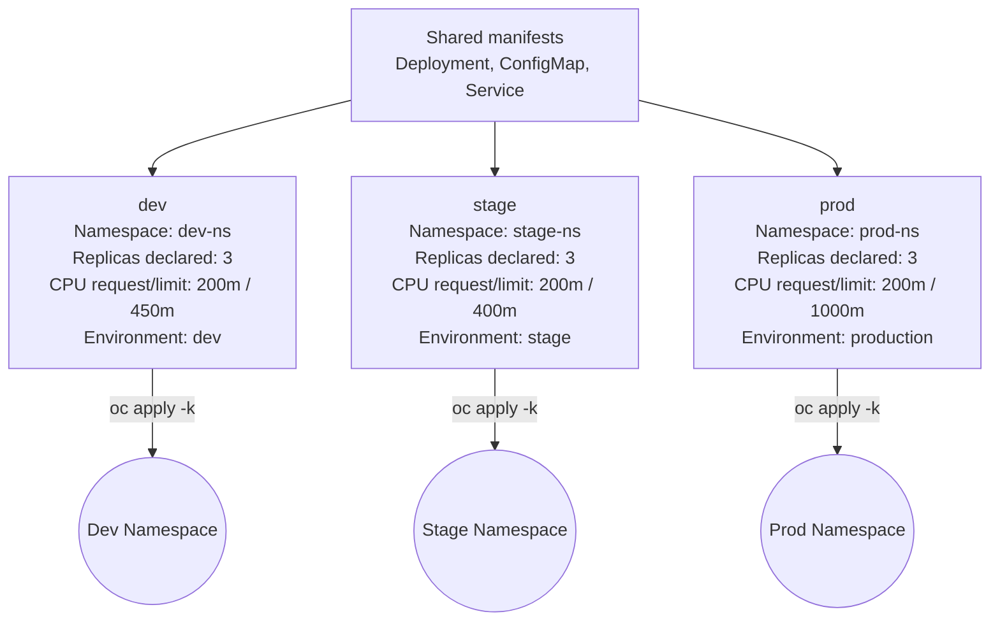

# OpenShift Kustomize Multi-Environment Deployment

This repository uses **Kustomize** to manage Kubernetes / OpenShift manifests across three distinct environments (`dev`, `stage`, and `prod`) using a shared `base` configuration and targeted `overlays`.

---

## 📁 Directory Structure & Architecture

````text
.
├── README.md
├── kustomization.yaml
├── deployment.yaml
├── config.yaml
├── service.yaml
└── overlays/
    ├── dev/
    │   ├── kustomization.yaml
    │   ├── patch-config.yaml
    │   └── patch-resources.yaml
    ├── stage/
    │   ├── kustomization.yaml
    │   ├── patch-config.yaml
    │   └── patch-resources.yaml
    └── prod/
        ├── kustomization.yaml
        ├── patch-config.yaml
        └── patch-resources.yaml
```

